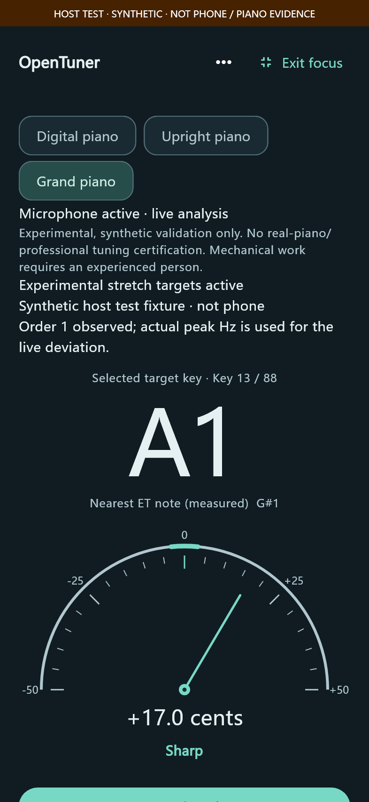
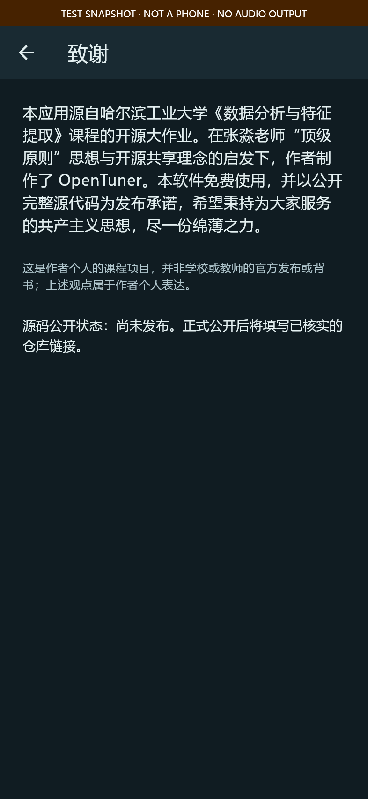

# OpenTuner

[简体中文](README.md) · [English](README.en.md)

A free, open-source Android guitar and piano tuner with local real-time pitch analysis, reference tones and a metronome. Built with Flutter, C++ DSP and Oboe; audio is processed on the device.

## Download the APK

**Packages have not been published yet.** See [GitHub Releases](https://github.com/yubowang224-dotcom/OpenTuner/releases). Current version: **0.7.0-beta.2 / versionCode 5001**, **Android 7 / API 24+**.

- **arm64-v8a is recommended for typical 64-bit Android phones.**
- **Choose universal if unsure of the architecture.**
- armeabi-v7a is for compatible 32-bit devices; x86_64 is for corresponding devices or emulators.
- **Do not uninstall an existing Debug app first.** Its certificate differs, so direct replacement is blocked. There is currently no user-facing profile export/import. [Installation](docs/install-release.zh-CN.md) · [Migration](docs/debug-to-release-migration.zh-CN.md).

## Features

- Live microphone Explore: note, Hz, cents, reliability, actual PCM waveform and spectrum.
- Seven six-string guitar presets, automatic/manual targets and stoppable synthesized pluck references.
- 88 piano targets, shared A4 reference, local profiles and sine references; digital piano defaults to equal temperament.
- Experimental mechanical-piano calibration: partial detection, inharmonicity fitting, guided measurements, individual model targets and saved profiles.
- Native sample-clock metronome: 20–300 BPM, meters, accents, subdivisions, Tap Tempo and separate start/pause/resume/stop.
- English/Simplified Chinese, light/dark/system themes, focus mode, App volume and offline licenses.




Screenshots are controlled renders of actual Flutter widgets, not phone audio measurements.

## Limits and validation

Mechanical-piano calibration remains **Experimental**. The default six-point model supports A1–A6 without extrapolation, not professional validation across all 88 keys. Synthetic errors do not establish phone, real-piano, mixed-source or vendor-wide accuracy.

Unreliable sound is explicitly invalid/uncertain while its real waveform and spectrum remain observable. Automatic target selection can confuse harmonics; use manual selection to confirm. Reference, microphone and metronome output are mutually exclusive. Navigation/background transitions stop audio without automatic resumption.

Automated checks cover Flutter units/widgets, C++ DSP regression, synthetic experiments and static inspection of three ABI/universal Release packages. Phone installation, end-to-end latency and real-piano validation remain pending. [Methods and results](docs/validation.md).

## Algorithm

Continuous PCM enters a preallocated bounded queue. A worker removes DC and extracts energy, YIN periodicity and spectral harmonic consistency. Candidate quality gates and continuous logarithmic pitch tracking reduce transient jumps. Raw estimates, tracked Hz, displayed numbers and rendered needle positions remain separate. Cents use the actual target frequency without octave folding to force an in-tune result.

Mechanical-piano analysis independently fits stiff-string partials and computes bounded targets using weighted partial coincidence. Observations, interpolated parameters and model predictions are distinguished. This is an engineering implementation based on YIN, pYIN and related research, not a claim to invent those algorithms or fully implement pYIN.

- [Audio processing](docs/audio-signal-processing.md) · [Features](docs/feature-extraction.md)
- [Tracking comparison and reproduction](docs/pitch-tracking-evaluation.md)
- [Piano foundation](docs/piano-foundation.md) · [Mechanical-piano model](docs/piano-calibration.md)
- [Architecture](docs/architecture.md) · [Audio bridge](docs/audio-bridge.md)

## Build and test

Pinned toolchain: Flutter 3.47.5 / Dart 3.13.4, JDK 21, Android SDK 36, NDK 28.2.13676358 and Oboe 1.11.0. See [Windows setup](docs/windows-setup.zh-CN.md). With these tools configured:

```powershell
flutter pub get --enforce-lockfile
flutter gen-l10n
flutter analyze
flutter test
cmake -S native -B build/dsp
cmake --build build/dsp --config Release
ctest --test-dir build/dsp -C Release --output-on-failure
flutter build apk --debug
```

Application ID: `org.opentune.tuner`. Without external signing configuration, Release builds remain explicitly unsigned. The official private key is not distributed. [Signing and maintainer backup](docs/release-signing.md). Official certificate SHA256:

`ae27b3e61d3d21419b6a45236bc9c56cbddcf05044a2311f56f4627d2eaf6892`

## Privacy and source

Audio stays local, with no default persistent raw recording, audio uploads, ads or tracking SDKs. Capture requires user intent and microphone permission. The Release manifest has no INTERNET permission. Piano profiles use local private storage. [Privacy](docs/privacy.md).

Implementation source, algorithms, resources, tests and build scripts are available under Apache-2.0; third-party components retain their own licenses. The source ZIP supplements the repository tree. Private keys, passwords, machine configuration, personal data and build caches are excluded.

## Acknowledgements

Special thanks to Zhang Miao (张淼), the instructor of Data Analysis and Feature Extraction. Zhang helped me recognize the importance of open-source sharing and “顶级原则” (original wording). OpenTuner aims to put these ideas into practice through source code, documented algorithms and reproducible experiments.

OpenTuner began as an open-source course project for Data Analysis and Feature Extraction at Harbin Institute of Technology. Inspired by teacher Zhang Miao’s “顶级原则” and the idea of open-source sharing, the author created OpenTuner. This software is free to use, with a commitment to releasing all source code. Guided by the communist ideal of serving everyone, the author hopes to make a modest contribution.

This is a personal course project, not an official publication or endorsement by the university or teacher. These statements reflect the author’s views.

[Apache-2.0](LICENSE) · [Third-party notices](THIRD_PARTY_NOTICES.md) · [Contributing](CONTRIBUTING.md) · [Changelog](CHANGELOG.md)
