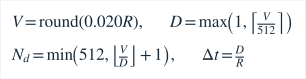
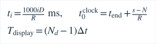

# 音频所有权与桥接契约

实现：`native/android/audio_engine.cpp`、`native/src/analyzer.cpp`、`MainActivity.kt`、`lib/audio/`。Android驱动尚待真机执行，以下描述实际代码，不将编译视为驱动运行证明。

## 线程和停止顺序

1. Kotlin主线程处理用户意图/权限/Activity事件。进程级单executor串行执行原生start、snapshot、stop，跨Activity重建仍保持唯一所有者。会话号由进程级AtomicLong单调分配。
2. Oboe输入回调仅向预分配65536样本（256 KiB）的SPSC队列拷贝float单声道PCM，更新无锁32位原子计数。无JNI/UI、FFT、锁、日志、I/O或分配。Oboe自身仍是第三方实现。
3. 唯一C++worker消费，执行80ms窗、20ms步进、生产Analyzer。队列满时producer丢新样本；worker遇丢样或积压超过200ms，安全丢弃自己可消费的积压，清窗、重置跟踪并发布无效快照。producer从不推进consumer索引、不覆盖未读内存。统计包括两种丢样。
4. worker以mutex发布固定上界结果。此mutex仅worker与非实时snapshot读取者使用。细节关闭后不生成波形/频谱展示数组；Hann FFT仍用于音高质量检查，属于必要分析。
5. stop先停止/关闭Oboe（等回调退出），再撤销worker运行标志、join并销毁Analyzer/缓冲。start失败与析构复用同一清理路径。流错误回调只置标志，控制executor读取后负责关闭。旧Activity的stop仅能关闭其自己的会话。

离开试测音会销毁页面controller并停止；进入paused/hidden/detached及Android onStop停止。不自动恢复录音，需用户再次开始。权限弹窗的inactive/onPause不单独停止；后台会取消待授权会话。系统授权结果即使迟到，也不能重开已取消的会话。没有后台服务或默认音频文件。

## 原生输入与兼容性

minSdk24保持不变。Oboe1.11.0静态链接，API24/25走OpenSL ES兼容后端，AAudio由Oboe按系统能力选择/动态加载；APK不直接依赖libaaudio.so。三ABI均实际交叉编译。API24后端、路由和权限弹窗均未在设备验证。

申请单声道float32、共享流、本机采样率（不指定采样率，无应用重采样）。Oboe可转换流格式/通道；显示的是Oboe App流的真实参数，不是未经确认的硬件ADC格式。先根据Android PROPERTY_SUPPORT_AUDIO_SOURCE_UNPROCESSED请求Unprocessed；失败则降级性能模式，最终VoiceRecognition。没有使用VoiceCommunication默认处理链。未知OEM AGC/降噪/回声处理状态始终标未知。

打开后控制线程仅记录一次参数logcat（OpenTuneAudio），不记录样本。API28+请求分配录音session以尽可能关联API29+clientSilenced；旧系统或不可用session无法提供该判据，仍检查权限、AudioManager静音、流错误、数据新鲜度。输入设备变化停止并要求重新开始，不偷偷更换源继续显示旧结果。

## 控制通道与旧ABI2字段

采用Kotlin MethodChannel + JNI传输控制与快照。没有引入音频插件或ffi包；33ms轮询、单个在途请求、有界快照使所有权清楚。手机桥接耗时仍需测量，如性能证据需要再迁移数据路径。

channel=`org.opentune/audio`：

| 方法 | 参数 | 结果 |
|---|---|---|
| start | referenceHz，400–480的有限正数（默认440，读取当前全局设置） | status、成功session、原生错误诊断；只在主动开始调用 |
| snapshot | details bool | status、data double列表、processing="unknown" |
| stop | 无 | 完成资源清理后reply；原生只关闭调用方拥有的session |
| settings | 无 | 打开本应用设置页，不自动授权 |

旧ABI2 data固定42个头字段，细节就绪时附加256个min/max值及最多512谱值。未就绪只传头，不伪造全零图。长度最多810；Dart兼容旧v1/v2，当前通用生产快照为下文ABI3，机械分音为ABI4；Dart检查有限数、格式、范围、长度、正频率、会话及单调序号。编码数组由JNI/JVM/channel各自复制管理，Dart不持有原生指针，也不释放C++内存。

| 索引 | 含义 |
|---|---|
| 0–5 | ABI、session、sequence、软件样本时钟窗末秒、新鲜度ms、validity(0静音/1不确定/2有效/3削波) |
| 6–13 | rawHz、trackedHz、MIDI(-1无效)、cents、score、DC去除后RMS dBFS、clipFraction、computeMs |
| 14–19 | 实际sampleRate、channels、Oboe格式(2=float)、后端(1=OpenSL ES/2=AAudio)、burst、capacity帧 |
| 20–23 | 回调样本计数、丢弃样本数、断点次数、流错误码 |
| 24–29 | 波形时长秒、谱bin Hz间隔、谱值个数、Oboe deviceId、inputPreset、录音sessionId(-1等表示不可用) |
| 30–41 | v2追加：noiseFloorDb、noiseKnown、levelMarginDb、centroidHz、harmonicRatio、CMNDF谷值、候选数、原始音高变化率cents/s、连续帧相容度、tracker状态(0idle/1candidate/2tracking/3switching/4uncertain/5lost)、候选合格bool、周期评分（重复用于扩展诊断） |
| 42–297 | 每个等时桶min/max的PCM满量程幅度，不是装饰曲线 |
| 298… | Hann单边峰幅 dBFS/bin，不是dB SPL；频率i*binHz |

新鲜度包含软件积压估计与发布后经过时间，不含未知硬件输入延迟。时间戳不是测得的声学端到端延迟。丢样后软件时间轴有断点并重置跟踪；RT计数用32位原子，worker扩展采样时间轴；诊断原子计数极长运行可回绕。

Dart只接收当前session且更新序号的结果；>250ms旧数据失效，500ms没有新帧停止，单次channel等待上限250ms。无效pitch字段不用于log计算，不用旧Hz显示有效调音。无可靠音高但仍有新PCM时图形继续显示。非Android/Web显示当前平台不支持，不自动注入演示。

## Portable C ABI

`native/include/opentune/c_api.h`定义ABI1、caller-size检查、OT_OK/INVALID/INTERNAL。单worker独占handle，input/output由调用方拥有且不保留；销毁前必须等调用结束。输入长度必须等于ot_window_size。错误返回不可当有效结果。App JNI与此ABI均调用同一个Analyzer类，host测试没有另写产品算法。当前App不通过Dart FFI调用ot_*，不能把host C ABI测试称作手机JNI执行验证。

自动化证据：CTest生产分析/环形队列/C ABI；Flutter模拟channel与页面测试。Oboe驱动、真实系统权限、Activity重建及输入隐私的完整执行证据仍待手机补齐。

## 阶段2.5参考音控制

- toneStart(hz): 有限20–5000Hz，成功status=playing及实际输出rate。不请求麦克风；先停止输入，再申请短暂媒体音频焦点并创建独占owner。此处“独占owner”是资源所有权，不是Oboe Exclusive共享模式。
- toneStop(): 停止当前Activity拥有的参考音；回调30ms收音，executor最多等待120ms后close，不阻塞实时线程。
- toneStatus(): 返回playing/idle/error及rate；自动结束时释放流/音频焦点。

全局native输入/参考输出互斥，跨Activity旧owner不能关闭新owner。NativeStart输入也主动清理参考音，NativeToneStart也主动清理输入，不能仅靠界面避免反馈。用户离开页面、后台或输出路由/焦点变化停止。播放后不自动恢复麦克风；用户必须手动开始试测音。没有输出音频文件或PCM上传。详见audio-signal-processing.md和真机教程。AndroidJNI/驱动/焦点实际执行仍需手机，模拟桥接不能替代。

## 吉他与节拍器所有权

OpenTuner标准六弦GuitarPage消费同一AudioCapture/Analyzer原始和跟踪快照，GuitarTuner仅选实际目标，音分按真实目标Hz计算；不折回八度。手动与±150c自动匹配独立，25c距离差判歧义，两个新快照确认换弦，确认期与越界文案分开。选弦/模式变化取消待播放旧目标并停止正在播的旧参考音，播放前停止采集，结束后至少250ms界面冷却、用户手动开始，不自动恢复。

MetronomeSynth经现有ReferenceEngine/Oboe输出，配置原子传入回调，音频样本调度而非Dart Timer；原子mailbox回传16字段快照，Kotlin串行单输出owner，Dart request隔离旧会话。所有输出与采集互斥；后台/焦点/路由停止。详情见metronome.md。Analyzer和140/50ms Tracker参数未改。手机焦点、路由和端到端执行仍需单独验证。

## 当前ABI3波形字段

0–41保持ABI2意义，24现在为显示窗口真实时长（无图为0）。42=PCM样本数0..512，43=样本间隔秒，44=显示起始样本时钟秒，45=实际交叉触发bool，46=整数抽取倍数1..8，47=worker显示提取耗时ms。随后为count个真实显示低通PCM浮点幅值，再为索引26指定个数的原有FFT谱值。48字段头+最多512PCM+512谱=1072 doubles；关闭详情只传48字段，42–47及24/26均为0。UI严格检查长度、时间边界、显示时间间隔和总时长（见下式）和合法bool。兼容ABI1/2的旧包络入口，与sampledWave显式区分。没有原始PCM文件录播或测试信号生产入口。快照释放/锁/线程策略不变。

## 参考输出与ABI2音量扩展

吉他toneStart增加voice(0正弦/1原创拨弦)与gain(0..1)，JNI形参严格对应；钢琴默认voice0/gain1保持原参考，输入/参考/节拍互斥不变。MetroConfig在Dart/Kotlin参数中增加整数gain(0..100)，与原拍速packed word分离，control将gain送入锁自由32位请求，callback内5ms slew，音量改变不触发节拍重置。节拍快照现在ABI2共17double，0..15原意义、16为回调收到的目标gain百分数；pending同时比较实际配置与gain。兼容ABI1/16字段默认100；MetroMailbox将gain与样本位置/配置按同一序列发布，不裸读共享浮点。见[reference-synthesis.md](reference-synthesis.md)及[验证结果](validation.md)。

## 钢琴扩展

ET钢琴以mode=piano选独立180ms/20ms分析器，nativeStart(JZDZ)请求参数在admission后保持不可变。分音分析nativePartialStart(JZDID)传会话、输入请求、A4、MIDI和有界关联中心，使用独立750ms/100ms分析器与ABI4；字段/长度/质量和新鲜度契约见[piano-calibration.md](piano-calibration.md)。A4/类型/档案/目标变化失效旧采集与应用意图，迟到结果不恢复旧状态。

节拍器当前为ABI3/19字段，旧ABI1/16、ABI2/17保留解码，详见[节拍器](metronome.md)。
