# 音频信号处理 / Audio signal processing

本文描述生产代码中的通用单声源分析。手机现场精度和端到端延迟仍需验证；基础方法归属原论文作者，工程组合、边界与复现实验分别说明。

## 采集、所有权与时间轴

用户主动开始后才申请麦克风权限。Oboe提供连续单声道float32 PCM，分析使用打开流的实际采样率，不在应用中重采样。优先请求Unprocessed，不可用时降级；厂商AGC、降噪与回声处理无法确认时标未知。OpenSL ES/AAudio由Oboe按系统能力选择，编译通过不代表旧系统实测通过。

回调只向预分配65536样本SPSC队列搬运数据及更新计数，不运行FFT、YIN、JNI、锁等待、分配、日志或I/O。满队列丢新样本，不覆盖未读内存。worker遇丢样或积压超过200ms清窗并重置跟踪。停止顺序为关闭回调、结束并join worker、释放缓冲；串行控制和会话ID隔离迟到操作。

令 <i>f</i>s 为实际采样率，<i>N</i> 为窗长，<i>H</i> 为步长，<i>W</i> 为固定差分积分长度：

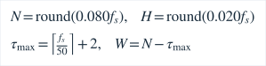

44.1kHz对应3528样本窗、882样本步；48kHz对应3840、960。搜索设计范围约50–2000Hz，低端约4周期/窗。固定积分长度对每个滞后相同。80ms观测成本不能由动画消除。结果时刻来自软件样本时钟：

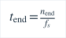

软件积压与发布年龄另计，不能把该时钟当硬件端到端延迟。

## 去直流、能量与电平

生产模块为 `native/src/features.cpp`。<i>x</i>[<i>n</i>] 是原始PCM，<i>z</i>[<i>n</i>] 是去均值样本；方括号表示离散采样索引。

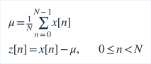

平方和 <i>E</i> 与均方值 <i>P</i> 是数字信号统计量，不是经标定的焦耳能量。RMS采用去均值后的样本：

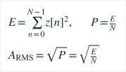

代码计算下式第一行，第二行为数学等价的幅度写法。功率下限10⁻¹²对应幅度下限10⁻⁶，不能混用：

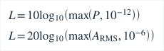

单位为dBFS，不是dB SPL。逐窗去均值不是连续高通滤波器，极低频漂移仍可能影响分析。−105dBFS仅是数值静音地板，不以旧版−60dBFS绝对门槛拒绝所有弱音；可测弱音仍需通过周期性与谐波门控。

## 削波与噪声底

削波使用原始PCM而不是去均值样本。指标函数在条件成立时为1，否则为0：

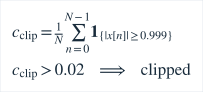

比例严格大于2%才进入削波状态。它只识别已达到数字极限的样本，不能保证发现更早的硬件削波。拒绝有效音高时仍保留真实图形和诊断。

噪声底只由未通过周期/谐波门控、且非削波的窗口更新。首次有效背景观测直接初始化，之后按dB值更新：

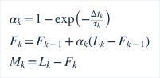

当当前电平低于上一噪声底时，时间常数为0.2秒；否则为3秒。<i>M</i>k 是电平余量，不是分离声源后测得的真实SNR，也不是硬拒检门槛。未观察背景时保持未知，非周期语音可能污染估计。这组时间常数与后文音高平滑不同。

## YIN差分与归一化

沿用de Cheveigné与Kawahara的周期检测思想[1]。所有滞后使用相同积分长度：

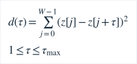

累积均值归一化差分函数包含明确的零累计差分数值保护：

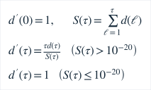

实现通过零填充FFT互相关和前缀平方和计算同一个差分函数，不将FFT最大谱峰当基频。相关FFT长度至少为窗长的两倍，避免循环混叠。

从短周期向长周期寻找首个归一化差分低于0.12的谷。即使超出2000Hz也先检查短周期，以免把4kHz纯音当2kHz；最终最多考察6个低于0.25的局部谷。周期评分：

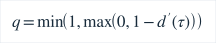

最终要求周期评分至少0.88、谐波一致性至少0.85，频率在49.95–2002Hz数值容差内。容差不代表扩大可靠音域。

## 插值、谐波检查与候选评分

先在CMNDF局部谷作三点插值，分母绝对值不大于10⁻¹²时偏移取零：

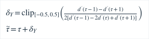

当滞后大于2、原始差分曲率大于10⁻¹²且初始分母有效时，再作余弦曲率校正；否则保留初始插值：

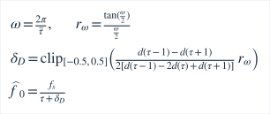

校正对单正弦差分模型成立，对复合谐波只是近似，不能用纯音误差代表复杂信号。角频率由初始插值滞后计算。

Hann窗频谱提取最多64个强局部峰，门槛为最大峰幅18%，搜索从第2个bin至源码规定频段上界之前。对数谱峰插值和完整定义见[特征提取](feature-extraction.md#f09)。记保留峰集合为 <i>𝒫</i>，符合整数倍关系的子集为 <i>ℋ</i>：

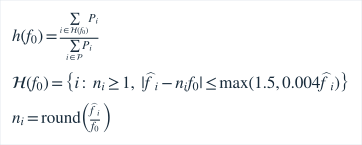

分母为零时一致性返回零。频率容差单位为Hz。它只拒绝部分明显不一致的混音，不能证明单声源或实现复音分离。

合格候选按下式排序：

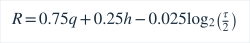

当前最小搜索滞后固定为2样本，因此评分的周期长度归一化分母为2。没有奖励接近旧频率，以免锁住旧八度。首个可靠周期之后超过1.35倍的长周期不能“救回”短周期被拒的候选。该保守规则抑制噪声下的错误低八度，也可能增加复杂弱基频拒检。

pYIN[2]研究多阈值候选及HMM/Viterbi解码。本项目借鉴候选与时序一致性思想，没有实现完整pYIN概率模型、离线Viterbi或训练校准。评分不是正确概率。

## 连续音高跟踪与视觉显示

生产 `PitchTracker` 在连续对数频率中跟踪，音高变化率仅用于连续有效观测诊断：

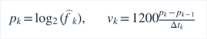

状态为idle、candidate、tracking、switching、uncertain、lost。初次或创新超过80音分时，候选相邻差异须小于35音分；周期评分至少0.97需2帧，否则3帧。确认后直接接受真实新音，不缓慢穿过无关中间音符；未确认帧不输出有效旧频率。

稳定跟踪的更新与创新定义：

稳定音时间常数140ms；连续3次同方向且创新绝对值大于12音分时切为50ms。时间步来自样本时间并限制在1–100ms；倒序或断续超过200ms重置。拒检帧不把旧Hz当有效结果，内部记忆最多保留200ms，之后重新确认。

原始频率、跟踪频率、数字显示、渲染指针四层独立。Flutter至多每33ms请求一个快照，数字最多每125ms更新，指针作32ms短插值。参照音在55–85音分区间作60ms确认，达到85音分不附加确认；更换参照时先60ms淡出、不可见时更换坐标、80ms淡入。参照锁定不锁住测量频率，不把不同音名下的音分拼接平滑。

无效时清空音名和Hz，指针灰显最多保持200ms后回中；灰色中心不表示调准。关闭详情停止波形/频谱传输和绘制，必要谐波分析仍运行。[真实PCM显示](waveform-display.md)与频谱单位见[特征提取](feature-extraction.md)。

## 目标、参考音与模式

音分始终相对实际目标频率，支持当前A4和已显式应用的模型目标：

最近标准音由当前A4和跟踪频率计算，其中MIDI四舍五入规则沿用生产实现：

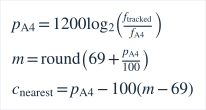

两频率必须为有限正数，无效零频率不能进入对数。最近标准音、指定琴弦/琴键和机械模型目标是不同参考，界面明确区分。

参考音在实际输出采样率下合成，含10ms起音、30ms收音和自动结束；吉他采用[拨弦近似](reference-synthesis.md)，钢琴使用正弦。输入、参考音和节拍器在原生所有权层互斥。播放后不自动恢复麦克风，避免自产声冒充外部调准；离页、后台、路由和焦点变化停止。

ET钢琴独立使用180ms/20ms分析器，机械分音使用750ms/100ms分析器；见[钢琴基础](piano-foundation.md)、[机械校准](piano-calibration.md)。通用80ms窗与50Hz下限不能当作全钢琴可靠调律保证。

## 引用、复现与局限

1. de Cheveigné, A., Kawahara, H. (2002). YIN, a fundamental frequency estimator for speech and music. JASA111(4),1917–1930. [DOI10.1121/1.1458024](https://doi.org/10.1121/1.1458024)。
2. Mauch, M., Dixon, S. (2014). pYIN: A fundamental frequency estimator using probabilistic threshold distributions. ICASSP. [DOI10.1109/ICASSP.2014.6853678](https://doi.org/10.1109/ICASSP.2014.6853678)，[作者论文](https://webspace.eecs.qmul.ac.uk/s.e.dixon/pub/2014/MauchDixon-PYIN-ICASSP2014.pdf)。
3. [Oboe1.11.0完整指南](https://github.com/google/oboe/blob/1.11.0/docs/FullGuide.md)。

尚无合法真实录音集与本版本完整手机声学测量；不做多声部分离，不把启发式评分解释成概率。合成对照包含覆盖率、拒检、错误八度、抖动和滞后，见[评估](pitch-tracking-evaluation.md)。本链路构成《数据分析与特征提取》课程实践；课程致谢不表示教师对软件性能背书。
