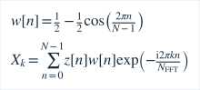
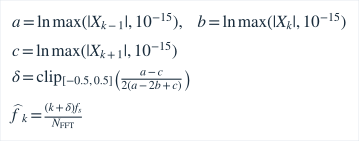
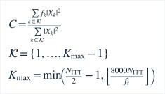
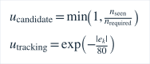
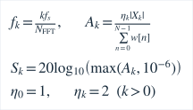

# 声学特征提取 / Feature extraction

生产Analyzer与主机实验共用features.cpp和PitchTracker；Android音频回调不计算这些特征。下表仅列作用与边界，完整数学定义在对应段落。

| 特征 | 定义 | 实际用途 | 局限 |
|---|---|---|---|
| DC均值 | [F01](#f01) | 去直流，建立去均值样本 | 逐窗去均值不是连续高通 |
| 平方和、均方值与RMS | [F02](#f02) | 描述去均值后的数字能量与幅度 | 不是物理声能或标定声压 |
| 数字电平 | [F03](#f03) | 静音数值地板与诊断 | dBFS不是dB SPL |
| 削波比例 | [F04](#f04) | 严格大于2%时拒绝有效音高 | 硬件早级削波可能不可见 |
| 噪声底与电平余量 | [F05](#f05) | 解释背景电平，支持可观察性 | 不是分离噪声后的真实SNR，不作硬门控 |
| YIN固定窗差分 | [F06](#f06) | 从重复周期提取基频候选 | 多声源、瞬态与非谐性可破坏唯一周期 |
| CMNDF | [F07](#f07) | 归一化差分，局部谷生成候选 | 阈值为工程假设，不是概率 |
| 周期评分 | [F08](#f08) | 质量门控，支持连续帧确认 | 错误整数周期也可能高分 |
| Hann窗与谱峰 | [F09](#f09) | 谐波门控及真实频谱 | 窗泄漏、有限分辨率和18%强峰门槛会漏弱分音 |
| 谐波一致性 | [F10](#f10) | 至少0.85支持YIN候选 | 整数谐波关系的多个声源仍可能通过 |
| 功率谱重心 | [F11](#f11) | 诊断频谱能量分布 | 不参与F0选择或调准判断 |
| 音高变化率 | [F12](#f12) | 区分变化与稳定性压力 | 无效后的首次观测不能当连续真值 |
| 连续帧一致性 | [F13](#f13) | 解释候选确认和创新相容度 | 归一化相容度不是正确概率 |
| 频谱坐标与幅度 | [F14](#f14) | 真实FFT bin频率、单边峰幅 | 不是功率谱密度，零填充不提高真实分辨率 |

### F01

**DC均值**。原始PCM为采样序列，求和范围覆盖整窗。幅度单位为FS。

### F02

**平方和、均方值与RMS**。平方和、均方值与RMS分别命名，避免把求和与平均混为一谈。

### F03

**数字电平**。生产实现为第一行；等价幅度下限为10⁻⁶。

### F04

**削波比例**。使用原始PCM的绝对值。指标函数条件成立取1，不成立取0。

### F05

**噪声底与电平余量**。仅非合格且非削波窗更新；首次初始化，随后下降0.2s、上升3s。此时间常数不是音高平滑常数。

### F06

**YIN固定窗差分**。所有滞后使用同一积分长度，不以FFT最大谱峰替代基频。

### F07

**CMNDF**。累积差分过小时返回1，避免除零。

### F08

**周期评分**。采用候选整数滞后处的CMNDF值；至少0.88合格，至少0.97可用较快2帧确认。

### F09

**Hann窗与谱峰**。窗与FFT按实际采样率定义。

局部峰以对数幅度三点插值；分母绝对值不大于10⁻¹²时偏移为零：

### F10

**谐波一致性**。保留峰的功率为非负权重；分母为零返回0。整数阶次由观测峰频率与候选比值四舍五入。

### F11

**功率谱重心**。通用模式集合不含DC，上界使用源码的严格小于关系。总功率为零返回0；ET钢琴另观测到0.45倍采样率之前。

### F12

**音高变化率**。变化率单位为音分每秒；连续对数坐标用于跟踪，不平滑跨音名的相对音分。

### F13

**连续帧一致性**。候选计数与所需计数的比值封顶为1；跟踪期使用以音分计的创新。

### F14

**频谱坐标与幅度**。当前显示前至多512个bin，DC不乘2；显示下限−120dBFS。

## 融合与模式边界

噪声底、电平余量和谱重心用于诊断，不因计算更多特征就宣称准确率更高。实际候选融合使用周期评分、谐波一致性、周期长度惩罚和质量门控；时序模块使用有效性、创新、方向一致性和时间间隔。

ABI3传输至多512个真实显示PCM点；显示专用FIR/抽取见[波形显示](waveform-display.md)。旧ABI1/2只兼容min/max包络，不把它连接成采样波形。关闭详情停止图形传输，必要的频谱质量检查继续。

ET钢琴与机械分音使用独立观察窗及模型，见[钢琴基础](piano-foundation.md)、[机械校准](piano-calibration.md)。原论文、线程边界和数学说明见[音频处理](audio-signal-processing.md)，同数据对照见[评估](pitch-tracking-evaluation.md)。
