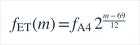
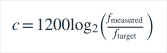

# 六弦预设与目标匹配

当前预设数据位于lib/model/guitar_tuning.dart，UI、自动/手动匹配与参考音共用GuitarPreset/GuitarString；数组依次是第6至第1弦，保留实际音区。各页统一读取当前A4设置（默认440Hz）并调用noteFrequency，不分别存储硬编码目标频率。

| 预设 | 第6弦 → 第1弦（实际八度） | MIDI |
|---|---|---|
| Standard | E2 A2 D3 G3 B3 E4 | 40 45 50 55 59 64 |
| Drop D | D2 A2 D3 G3 B3 E4 | 38 45 50 55 59 64 |
| D Standard | D2 G2 C3 F3 A3 D4 | 38 43 48 53 57 62 |
| Half-Step Down | Eb2 Ab2 Db3 Gb3 Bb3 Eb4 | 39 44 49 54 58 63 |
| DADGAD | D2 A2 D3 G3 A3 D4 | 38 45 50 55 57 62 |
| Open D | D2 A2 D3 F#3 A3 D4 | 38 45 50 54 57 62 |
| Open G | D2 G2 D3 G3 B3 D4 | 38 43 50 55 59 62 |

目标频率与音分使用同一参考：

范围73.416–329.628Hz，仍在已有Analyzer初始范围内，无全钢琴范围扩展。UI预设用ASCII #/b，吉他检测音名显示#以降低字形依赖；例如目标Eb2与检测D#2为同频异名，不是八度改变。Explore已有显示选择和音高分析实现不改。

自动匹配按当前六目标的绝对音高距离排序：最近目标距离>150c则越界，最优与次优距离差≤25c则歧义；两个不同的新快照确认新目标。手动目标不折叠八度，测量为目标两倍时偏差+1200c。只有单F0时，物理弦的泛音可能接近另一弦实际目标，不能从相同频率唯一确认物理弦；手动选择有助于解释，不能把孤立谐波当作不存在的基频。

## 预设切换事务

选择不同预设立即取消旧播放意图，AudioCapture.stop同步清空读数并使在途poll generation失效，然后等待原生输入和旧输出停止。手动重置第6弦；自动清空所选/待确认目标，保持自动选择方式。界面显示停止及重新开始提示，不自动恢复麦克风。关闭未完成时禁止新采集/播放；预设关闭generation与播放intent分离，因此此时选手自动/后台不会使控件永久禁用。模型也拒绝重新解释切换时保留的同一快照。

预设选择采用页内展开列表，专用PageStorageKey，收起后保持紧凑。对延迟native stop的弹出Dropdown/Popup原型，Widget中复现了object.dart:6723语义几何断言；SDK内部原因未完整归因，未改SDK、关闭语义或吞异常。页内选择避免本场景的modal overlay关闭交互，同一延迟/后台/待播放案例及实际App主题/语言/极简/导航逐帧测试通过。它不代表修复所有Flutter框架故障。用户反馈此前手机红屏已解决，历史framework6430精确断言仍未在本机独立复现。

## 可复现实验与边界

native/tests/guitar_preset_tests.cpp独立字面MIDI表检查42目标；336条件=42×44.1/48kHz×纯音/强二次/弱基频/缺失基频。每段1.2秒、峰系数0.18，分音系数分别[1]、[0.12,1,0.45,0.2]、[0.04,1,0.65,0.2]、[0,1,0.65,0.3]，相位0.3rad。0.3–1.2秒所有稳态帧进入分母，拒检单列；不挑成功帧。另两采样率静音/固定种子20261019 LCG均匀噪声。具体数值见[验证结果](validation.md)，目标为每条件有效≥95%、median≤2c/P95≤5c、稳态八度0，未事后降低标准。

Flutter另验证42目标/非440比例、实际UI所有参考音频率、手自动/歧义/越界/八度、过期/无效/迟到结果和预设/在播/待播放取消。真实吉他、人声、拨弦瞬态、房间混响、设备响应仍无手机验证；合成稳态结果不等于实琴准确度。

预设名称与低到高关系参考乐器厂商资料：[Fender alternate tunings](https://www.fender.com/articles/setup/tune-like-a-rock-star)、[Open D](https://www.fender.com/articles/setup/open-d-tuning)、[Drop D](https://www.fender.com/articles/setup/drop-d-tuning-on-guitar)。D Standard与Half-Step Down分别由标准表整体下移2、1个半音推导，实际八度与频率由上式明确，不复制调音网站的谱峰检测实现。
