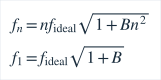
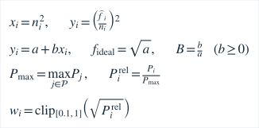
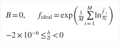
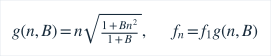
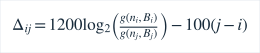
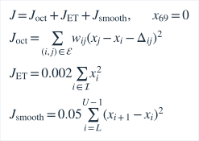
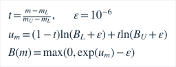

# 机械钢琴合成实验协议

测试数据为原创合成PCM；预先固定条件、统计区间和阈值，失败不通过事后筛选隐藏。

## 模型与可辨识边界

采用固定端点刚弦近似，理想参数与实际第一分音分别定义：

实际目标/参考音的A4指**第一分音**。至少4个不同阶次、阶数gcd=1、足够阶数跨度；两个峰或只有偶数阶不能构成可靠B证据。实际谱峰、残差、噪声代理、阶次歧义/可分辨双峰与连续4帧稳定性共同判定，不把质量评分当正确概率。所选琴键只约束“用户弹奏的是哪一键”的关联范围，不强制频率/固定B作为答案。

新独立PartialAnalyzer：750ms Hann窗、100ms步，实际采样率16..96kHz（其他明确拒绝），FFT/拟合只在worker，原实时回调仍只搬运有界PCM。局部log谱峰插值，B网格仅用于初始化阶次关联；回归坐标、权重及非负斜率支路的参数估计为：

微小负斜率投影支路另按生产代码重拟合：

图中峰功率先相对所有保留强峰的最大功率归一化，再取平方根并限幅得到回归权重。随后复核频率残差/观测解释率、B敏感度和稳定性。弱基频可由不全的高分音共同约束；高音有限带宽或不可辨识时拒绝，不套经验B。模型忽略桥耦合/多弦/纵向分音；小幅调整近似B不变，张力明显变化后需重新采样。

参考：

- Rigaud/David/Daudet, [A Parametric Model of Piano Tuning, DAFx2011](https://www.dafx.de/paper-archive/2011/Papers/53_e.pdf)。刚弦理想参数、第一分音和倍频程调律的区别；本项目不复制论文软件。
- 同作者，[JASA2013, DOI 10.1121/1.4799806，作者机构稿](https://www.institut-langevin.espci.fr/IMG/pdf/2013_a_parametric_model_and_estimation_techniques_for_the_inharmonicity_and_tuning_of_the_piano.pdf)。测量B/调律的联系、非理想分音与高音限制；不宣称完整NMF/复音实现。
- [Gràcia/Sanz-Perela, The wave equation for stiff strings and piano tuning](https://arxiv.org/abs/1603.05516)。分音重合/拍频与音程的关系；本项目目标函数只是明示权重的工程近似，不是完整听觉不协和模型。
- 原YIN/pYIN引用继续保留，M3单弦分音拟合并非上述基础方法原创。

## 拉伸目标的事前约定

生产曲线求解为可独立主机测试的纯Dart声学模型，C++负责PCM/分音/B；不在UI帧或音频回调反复求解。目标始终是第一分音。规范化分音比与目标函数如下。目标偏移相对当前十二平均律，A4偏移固定为零：

边为单八度2:1（权1）/4:2（.25）、双八度4:1（.1），乘观测质量/插值折减权；A4锚定约束见上式。ET弱先验和邻键连续正则连接不同音级的八度链，权重是工程假设、无职业听感最优保证。不用任意漂亮曲线拟合。B=0应严格回到ET。

至少5个有效测量点，含A4，跨≥36半音，A4两侧有数据，邻接测量间隔≤12半音；默认引导A1/A2/A3/A4/A5/A6。非谐性参数仅在测点包围范围内按下式插值，并标明模型推算：

**不外推**。默认6点仅支持A1–A6，不能伪称88键均已个体校准。范围外明确ET回退，或提示未校准；过大空档/数据不足禁止生成。任何重采/撤销/样本/A4/类型变化使旧曲线失效；保存精确样本、源、时间、算法版本、区间/目标，读取重算核对，不信任篡改目标值。

## 事前合成评估

- 主矩阵：MIDI33/45/57/69/81/93 ×44.1/48kHz ×B=0.00003/0.0001/0.0004/0.0015/0.006 ×完整分音/弱一阶/缺一与四阶/每分音±0.15c固定扰动，共240条件。实际生成至min(18kHz,0.42fs)、最多16阶，幅度系数控制非削波、1.5秒段，1.1..1.5秒全部分析帧作分母；保留启动/无效行。不以成功帧误差隐去拒检。
- 初始目标：上述约定稳定单弦≥90%总接受，第一分音P95≤2c；B中位相对误差≤10%、P95≤25%，另报告绝对误差和每条件拒检/失败。无法达到则保留失败，不改真值/区间掩盖。
- 扩展：A0/C8、低采样率带宽；主范围子集20/10dB固定噪声；静音/白噪/削波/只有两峰/只有偶数阶/错误琴键/扰动分音/分辨出的双弦/持续滑音，分别统计不可靠拒绝。相距3c等未分辨双弦单列探索，不承诺可识别一切多弦。
- 每帧输出原始理想弦参数、第一分音和非谐性参数、残差、敏感度、有效分音/阶数、理由、稳定帧数和耗时；报告首个ready延迟、失效、重采响应、CPU/RSS及主机环境。重叠帧不是独立统计样本。
- 曲线主机测试：B=0→ET，A4第一分音锚定、两种不同B分布→不同曲线、目标函数比ET改善、模型/实测标识、支持范围无外推、少点/大空档/无A4/过期样本拒绝、保存读取重算一致；可复现CSV/图表。

## 状态与存储验证

- 机械类型显式Experimental入口，真实采样→质量/拒绝理由→接收/重采/撤销→保存恢复→生成/审阅/应用目标；不输出危险张力调节步骤。电子钢琴仍ET，未来专业曲线不静默应用。
- 原schema1基础档案可读，安全迁移schema2，旧文件备份/未知schema保护/陈旧revision/容量边界保留；不存PCM，不联网。来源标明Android麦克风入口与设备参数，不能将主机fixture作实琴证据。

实现中边界细化（扩展测试前固定）：采样阶次关联中心为ET，应用已校验曲线后中心为该键模型目标（限定相对ET±150c），原±60c关联门限不放宽；A4继续用于音名。关联中心只是已知键约束，不替代回归频率。扩展±90c目标且真实音再偏±17c，检验量测/音分真实跟随；越界/旧中心另拒绝。相邻物理键若落在同一频率范围无法仅由麦克风证明键身份，需用户确保单键声源。

重采闭合：已拉伸键可显式选择先前相容模型的有界搜索中心；每个样本记录associationHz/模型版本，ET初采门限不变。改样本即使活动曲线失效，历史searchHints可保留用于再次采样，绝不作为当前参考音/目标；不足数据仍禁止生成。A4/琴型不匹配时不使用旧提示。读写校验边界/版本和来源配对，重建曲线后才可应用。
