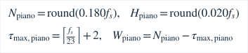
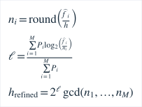

# 钢琴基础测量：音域、模型与边界

本文描述基础ET分析。电子钢琴默认ET；机械类型可另行进入[Experimental分音校准](piano-calibration.md)，两种声学模型不混同。

## 目标与观测分开

88 键为 MIDI 21..108，序号 “MIDI编号减20”，A0..C8。目标由当前全局A4频率计算：


A4 可选 400..480 Hz，故 A0 为 25..30 Hz、C8 为约 3805.46..4566.55 Hz。目标选择仅影响目标 Hz、参考音和仪表坐标，**不会传入分析器作为测量答案**。实测音名由相对当前 A4 最近的 MIDI 得出；八度错误保留实际偏差，不折回目标。自动选键未启用。没有可靠音高时，音名/Hz无结果，仪表失效，不显示调准。

## 独立分析配置

吉他/试测音的已认可 `Analyzer`、`features` 和 `PitchTracker` 源码保持不变。钢琴选择新的 `PianoAnalyzer`，在同一个 Android DSP worker 中使用，主机测试也直接链接该类。回调仍仅搬运 PCM 到有界 SPSC，未加入 FFT、锁或分配。两种分析器只创建一种；RT/worker 的所有权与停止顺序沿用原实现。

钢琴使用独立窗长、步长和固定积分长度，不重采样，采样率来自已打开的Oboe流：



最短 A0=25 Hz 在窗内约4.5周期。搜索低端约23 Hz、高端约5 kHz；不是全设备保证。实际输入采样率低于16kHz时 明确返回 `piano_sample_rate` 错误，8 kHz不以错误低八度代替 C8。44.1/48 kHz验证了全矩阵，16 kHz只验证极端纯音与参考音，其他采样率尚未实测。

预处理、固定积分窗 YIN 差分/CMNDF、噪声底、削波门控与跟踪定义见 [信号处理](audio-signal-processing.md) 和 [特征](feature-extraction.md)。积分长度见上式，FFT交叉相关只加速差分计算，**没有把最大谱峰当 F0**。周期评分至少0.88、谐波一致性至少0.85、可见削波>2%拒绝。−105 dBFS仅是数值静音地板，不用绝对响度拒绝所有弱音。

钢琴 Hann 频谱零填充至 至少四倍窗长的最小二次幂长度，局部峰以 log 幅三点插值；保留达到最大幅度18%的强峰，最多64个，观测至实际采样率的0.45倍之前。每个合格YIN候选 h 对观测峰按下式确定整数阶次，仅保留1..12阶且偏离≤60c的峰。记通过整数阶次与60音分关联门限的峰数为 <i>M</i>，对应观测峰功率为 <i>P</i><sub>i</sub>：



上述加权均值仅在总峰功率为正时计算；无合格观测峰时保留原YIN候选。它把长周期子谐波候选按**实际观测阶数**归一到最短共同周期；例如4/6/8阶归一为2/3/4。单独一个高阶峰不能证明未观测的低基频，通常解释为实际可见周期。缺基频需要多个共同约束的分音。该步骤是已有YIN/谐波思想的工程组合，不是基础理论原创；不是B拟合、非谐性归一化或完整pYIN。谱峰阈值、近整数门槛可能拒绝弱分音或机械钢琴，整数关系多源可能仍通过，不能做多声部分离承诺。

生产跟踪在连续 log Hz 上采用已认可的140/50 ms策略与确认/超时，不对跨音名 cents 串联平滑。相对目标的仪表与实际音名分开；显示数字最多8次/秒，渲染独立插值。180 ms窗口造成的动态滞后不能由动画消除。当前钢琴页不开放截断频谱图，试测音原有真实波形/频谱保持原配置。

## 参考音与会话

全部88键使用同一 `ToneSynth` 正弦，实际输出采样率决定相位步长；峰幅0.15 FS，10 ms起音、30 ms收音、3秒后自动收音。目标频率达到输出采样率的0.45倍时明确拒绝，不折八度。选键不自行播放；点击参考音先停止输入，播放与采集互斥，结束至少250ms界面冷却，**用户主动重新开始测量**。换键/类型/A4/档案/页面/后台取消旧播放意图。

全局A4变更递增音频配置代次，重建各页采集对象并清空旧快照；晚到授权或结果不能恢复旧读数。Android不可变 `InputRequest` 在busy检查之后保存输入参数，拒绝请求不能修改等待授权中的原会话。这是主机JVM/Flutter模拟验证，不能代替系统授权弹窗。

## 证据与复现

实际条件与结果汇总见[验证](validation.md)。执行：

```powershell
. ./tools/activate.ps1
cmake -S native -B build/m2-dsp
cmake --build build/m2-dsp --config Release
ctest --test-dir build/m2-dsp -C Release --output-on-failure
python tools/report_piano_m2.py
python tools/generate_piano_tones.py
```

报告工具校验认可通用DSP的已提交源指纹，读取生产执行器的全部CSV，生成低/中/高分区、误差/覆盖/抖动与动态图。原始CSV和WAV在ignored目录，不依赖旧机器私有数据即可重新生成。合成结果不代表手机采样时钟、端到端声学延迟、人声、混音、非谐性、多弦或实琴精度。基础研究引用沿用 YIN（de Cheveigné/Kawahara 2002，DOI 10.1121/1.1458024）及 pYIN（Mauch/Dixon 2014，DOI 10.1109/ICASSP.2014.6853678），原论文链接见信号处理文档。
