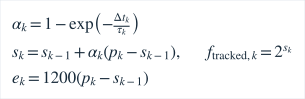
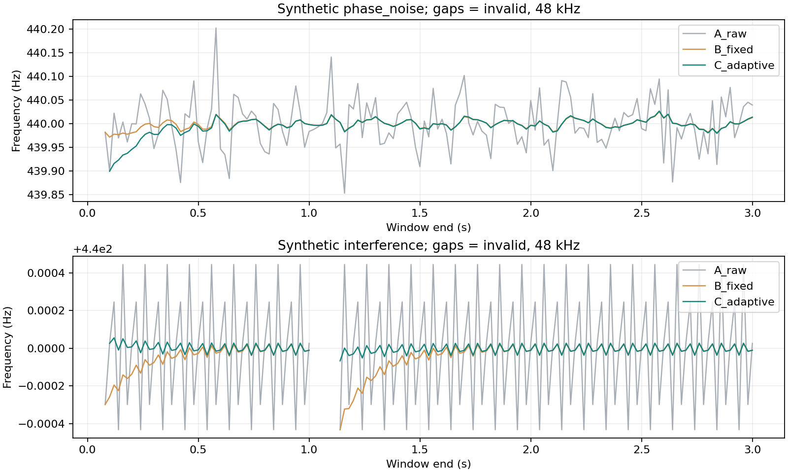
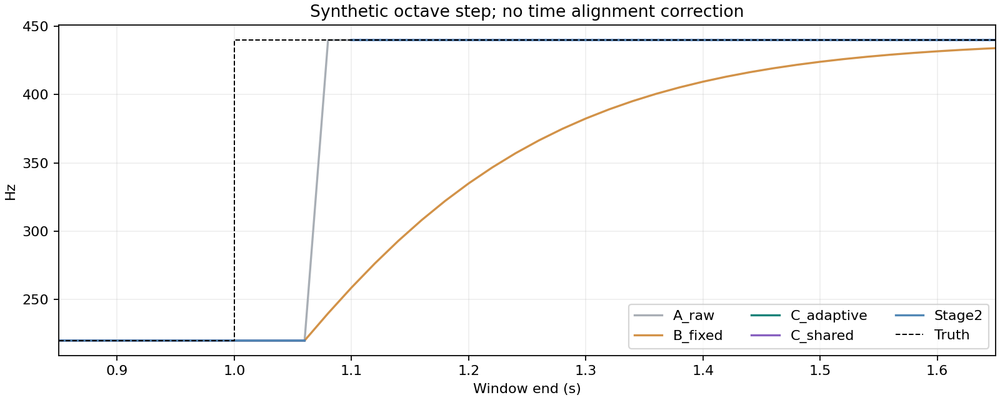
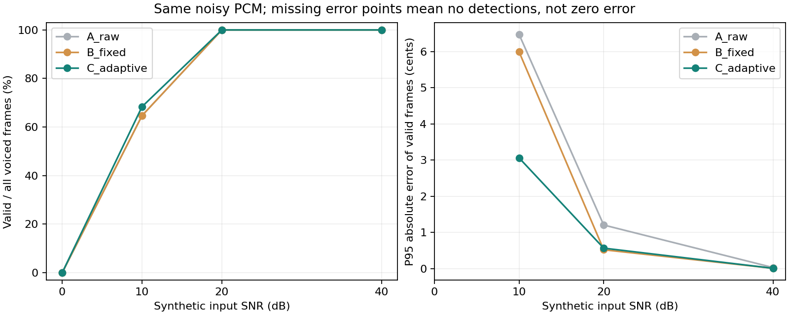

# 音高跟踪对比实验

全部数据为原创合成PCM，未使用真实录音，未测手机端到端延迟。实验同时报告误差和有效覆盖率，保留拒检、失败及动态滞后。

## 方法与统计约定

改动前协议见[stage25-experiment-protocol.md](stage25-experiment-protocol.md)。原始阶段2实现冻结在`native/tests/baseline_stage2`，来源f72db465e559，provenance.json记录SHA-256与仅有的命名空间、include、暴露已有资格布尔值改动；Android不链接此副本。

- A_raw：冻结的阶段2帧估计和质量门控，移除其时序输出。
- B_fixed：与A完全相同观测，在连续对数频率上使用150ms固定时间常数；失效立即不输出并重置EMA。
- C_adaptive：当前生产多候选/质量门控+自适应状态机。无效帧不输出旧Hz。
- C_shared：把A观测喂给同一新tracker，分离前端和时序贡献。
- Stage2：冻结旧版真实tracked输出，用作旧生产跟踪基线。

频率误差按实际目标比值换算，固定和自适应平滑都在连续对数频率上运算：




每套前端78个条件（39条件×两个采样率），每条件3秒、147帧，共11466帧，五种方法共57330条结果。0.3–3秒固定为统计区间，启动、阶跃、失效使用完整序列；不事后裁选成功片段。误差相对窗末真值，不平移对齐以隐藏延迟。每条件同时输出全部有声帧数、有效数、拒检率、有效帧median/P95/最大cents、八度错误数、无音高段假有效数、计算耗时。仅成功帧的误差必须与覆盖率一起读；无有效帧的误差写空，不能填零。

稳定音抖动为输出相对恒定载频误差的标准差。真实颤音、滑音和阶跃不当“稳态噪声”计算SD。随机相位扰动试验的440Hz仅为载频，含相位变化的瞬时频率并非恒440；其统计是稳定性压力指标，不是严格瞬时音高准确度。SNR为生成器已知的正弦功率/白噪声功率比，不等于App噪声底代理。

固定种子20261025；mt19937 + C++ normal_distribution在同一运行环境可复现，但标准库分布实现跨平台未必逐样本相同。逐条件分组键包括类型、采样率、振幅、base_hz与方法，共390行；动态真值独立按时间记录。production_前缀诊断列来自新生产前端，同帧重复用于对照，不冒充A/B的特征。保留环境、源码、完整CSV及哈希；未来跨平台逐样本复核需固定噪声文件或自实现分布。生成信号及振幅/谐波/动态时刻见执行器`native/tests/evaluation.cpp`和预注册协议。

## 结果与可查看图表

[逐条件完整CSV](evaluation-stage25/summary.csv) · [自动生成比较表](evaluation-stage25/results.md)。表中行含多频率时，覆盖率汇总全部帧，P95与SD用最差单条件值，不能误称合并分位数。原始逐帧CSV在忽略的`artifacts/stage25-evaluation/frames.csv`，复跑可重建；阶段2原138条件/9936帧回归仍单独执行，门槛未降低。







当前48kHz代表结果（精确逐条件数见CSV）：

| 输入/指标 | A原始 | 固定平滑 | 新自适应 | 旧阶段2跟踪 |
|---|---:|---:|---:|---:|
| 20dB噪声抖动SD / cents | 0.573 | 0.227 | 0.244 | 0.444 |
| 20dB噪声P95 / cents；覆盖率 | 1.204；100% | 0.519；100% | 0.564；100% | 0.920；100% |
| 相位扰动SD / cents（载频参考） | 0.216 | 0.034 | 0.038 | 0.129 |
| 阶跃首次进入±10c / 三帧确认 ms | 80 / 120 | 780 / 820 | 100 / 140 | 100 / 140 |
| 线性滑音P95 / cents | 12.918 | 49.121 | 24.048 | 17.280 |
| 10dB噪声覆盖率 / P95 cents | 64.7% / 6.480 | 64.7% / 5.997 | 68.4% / 3.062 | 50.7% / 5.996 |

这组结果说明平滑降低抖动，但对滑音和5Hz颤音存在可观滞后；**新算法并非所有指标优于旧版**。与旧阶段2输出相比20dB抖动降低约45%，阶跃确认未变；与A原始相比降低约57%，但滑音P95增大。低信噪比仍有拒检，0dB全部拒检。弱音峰幅0.0002/0.001的干净合成220Hz在新算法统计段100%检出，原算法因−60dBFS门控全部拒检；这不保证手机同样弱音可测。

统计段内新跟踪在全部有声真值帧仍有8帧被判为八度错误，均来自220→440阶跃的两个采样率、各4帧（每条件4/136≈2.94%）：窗末真值已切换，80ms窗内仍有旧音。这些帧保留在分母和最大误差中，不因“可解释的窗口滞后”删除；A/B/C_shared/旧Stage2也各8帧。静态/10dB噪声中的错误八度为0，不等于动态全序列零八度错误。

静音、固定随机噪声、脉冲及非整数关系双音没有有效输出；边界停声后的80ms混合窗可仍包含旧音，不能将窗末真值与窗内内容混淆。48kHz首次显示失效在停声后60ms，内部轨迹记忆200ms另行超时，UI失效指针灰显保持最多200ms；它们不是同一个延迟。

## 失败实验与调整

首次多候选实现允许更长周期挽救被拒绝的短周期：10dB噪声下有48个有效帧严重偏低八度（含启动区，两个采样率合计），最差P95约1204c。保留[首轮按类型/振幅聚合摘要](evaluation-stage25/first-iteration-summary.csv)，完整原始记录在`artifacts/stage25-first-iteration`。修复为禁止超过首个可靠周期1.35倍的候选“救回”，加入专门噪声八度回归；最终结果的条件、分母和门槛不变。此规则的代价是某些复杂信号可能宁可拒检，未来需实录验证，而不是继续加候选博取覆盖率。

计算性能、温升和端到端延迟应在目标设备独立测量；合成音频时间轴响应不包含硬件缓冲或屏幕延迟。

## 复现

已配置Windows仓库PowerShell：

```powershell
pwsh -NoProfile -File tools/test-stage25.ps1
```

该命令实际构建/运行两个C++测试，随后用Python读取完整CSV生成图表和联合覆盖/误差检查；不是从表格手工填数据。Python需numpy/matplotlib，版本见tools/requirements-evaluation.txt。通用平台可分别执行：

```text
cmake -S native -B build/dsp -DCMAKE_BUILD_TYPE=Release
cmake --build build/dsp --config Release
ctest --test-dir build/dsp -C Release --output-on-failure
python tools/evaluate_tracking.py
```

若失败保留日志和所有失败条件，不更改门槛掩盖失败。后续应补合法实录、多种手机、真实哼唱/泛音/不稳定语音、不同噪声与音频路由，并量测外部激励到屏幕/音频输出的实际时延。YIN/pYIN原论文与工程原创性边界见[audio-signal-processing.md](audio-signal-processing.md)。


## 钢琴模式

ET钢琴独立使用180ms/20ms的PianoAnalyzer；机械校准独立使用750ms/100ms的PartialAnalyzer，均在同一worker分析真实采样率PCM，不改通用跟踪参数。详见[piano-foundation.md](piano-foundation.md)、[piano-calibration.md](piano-calibration.md)及[验证结果](validation.md)。
