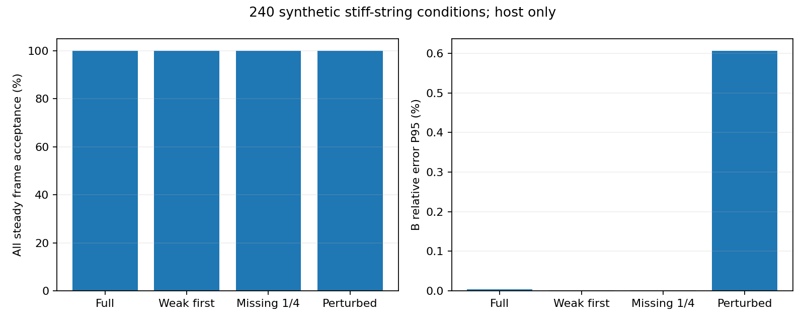
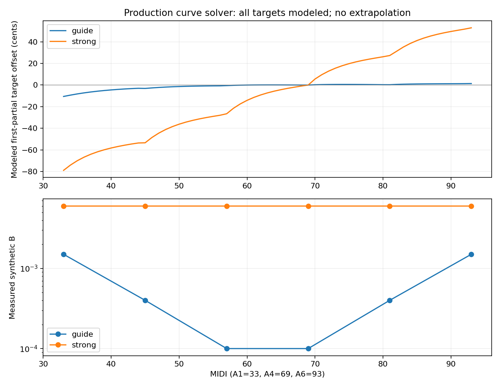
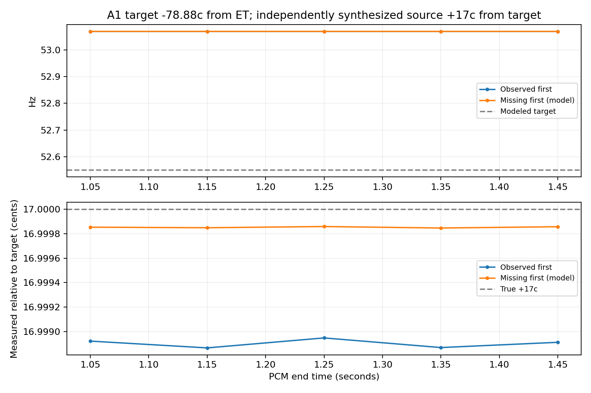

# 验证方法与结果

数据类别严格区分：原创合成PCM、受控页面/桥接夹具、真实录音、手机现场测量。下列声学结果全部来自主机合成信号；没有实琴或手机端到端精度认证。测试直接调用App使用的生产分析器。

## 通用音高与跟踪

[静态协议](stage-2-test-protocol.md)固定44.1/48kHz、80ms窗/20ms步，纯音50–2000Hz、幅度0.03/0.3/0.8，统计0.3–1.5s全部帧；有效误差与覆盖/拒检同时报告。原始基线138条件、9936帧，纯音有效5856/5856，P95绝对误差0.0131096c。此数值仅属于无噪合成基线，不是手机或复杂声音精度承诺。[完整原始基线结果](stage-2-dsp-results.md)。

[跟踪对比](pitch-tracking-evaluation.md)使用同一PCM对比原始估计、固定150ms平滑、自适应跟踪及共享观测消融。78条件/前端、五种方法共57330行，预先固定启动区间、动态真值和拒检分母。

48kHz/20dB合成噪声下，原始/固定/自适应输出抖动SD分别0.573/0.227/0.244c，覆盖均100%；阶跃三帧确认120/820/140ms，滑音P95误差12.918/49.121/24.048c。平滑改善稳定性，同时增加滞后；不只报告有利指标。图表和逐条件CSV见对比文档。

## 机械钢琴

[模型](piano-calibration.md)与[实验协议](m3-protocol.md)固定6个A键、44.1/48kHz、5个B值、4种分音条件，共240条件。每段1.5s，1.1–1.5s全部稳态帧作分母；启动和无效帧另列。结果见[evidence/m3-results.json](evidence/m3-results.json)。

| 指标 | 主机合成结果 |
|---|---:|
| 稳态接受 |960/960 |
| 全帧ready（含启动） |1200/1920 |
| 模型第一分音绝对误差P95 |0.0175709 cents |
| B相对误差中位数 / P95 |0.00000161674 / 0.00589999 |
| B绝对误差P95 |4.07105e-7 |
| 最大单条件稳态抖动SD |0.000306359 cents |

750ms窗加连续4帧确认首次稳定约1050ms。76扩展条件分别考察噪声、削波、仅偶数阶/两峰、滑音、键关联和不可辨识边界；高音有限分音可正确拒绝。32条件用实际Dart曲线→独立非谐性PCM→生产分音拟合/参考目标闭环验证，不是把目标送回作为答案。





默认6点仅给A1–A6的61个模型目标。B的测量/插值和所有目标的模型性质均明确标记，不外推，不构成职业听觉最优或多弦分离保证。

## 软件与APK

已有208项Flutter测试、12组原生CTest及最终受影响回归记录；签名/元数据变化另运行静态分析和13项针对测试。干净源码独立执行依赖锁定、本地化生成、7项smoke及独立arm64无密钥AOT构建，构建前后535个输入源文件哈希一致。文档整理不改变对应应用构建输入。

0.7.0-beta.2/code5001三ABI与通用APK均完成apksigner、aapt、JNI/DEX、离线许可证、实际Manifest、64位ELF LOAD及ZIP16KB静态检查。[包元数据和文件哈希](release-package-metadata.json)。静态合格不等于已在所有架构/16KB手机运行。

## 复现

```powershell
flutter pub get --enforce-lockfile
flutter gen-l10n
flutter analyze
flutter test
cmake -S native -B build/dsp
cmake --build build/dsp --config Release
ctest --test-dir build/dsp -C Release --output-on-failure
```

跟踪图表：`tools/test-stage25.ps1`和`tools/evaluate_tracking.py`。其他逐条件实验入口为`tools/report_guitar_m1.py`、`tools/report_piano_m2.py`、`tools/report_piano_m3.py`，使用其参数指定实际build目录。生成器源码、条件和固定种子随仓库提供；完整运行输出在ignored build/artifacts中重建，不从手填数值绘图。

## 设备记录

未完成项包括实际安装/升级、系统权限/隐私开关、路由/焦点、长时功耗/CPU/PSS、声学到屏幕端到端延迟、API24/16KB设备运行及真实机械钢琴。使用[设备记录模板](device-test-m3-template.md)逐项填写。哼唱只检查响应；电脑扬声器播放测试音是空气链路功能检查，不是专业声学校准。
