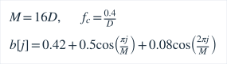
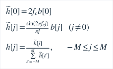
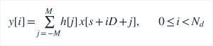
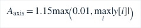

# 真实PCM时域显示：数学、线程与可复现实验

本模块只改绘图数据，不修改YIN、候选评分、音高Tracker或140/50ms时间常数。生产入口仍是Oboe的真实PCM；测试信号没有进入生产App的接口。频谱仍独立使用原Analyzer的80ms帧、Hann窗和单边峰幅dBFS/bin，不能从显示曲线反推频谱。

## 从样本到坐标

worker保有80ms真实帧。令 <i>R</i> 为实际采样率，<i>V</i> 为约20ms的源样本数，<i>D</i> 为整数抽取倍数，<i>N</i><sub>d</sub> 为显示点数：


实际采样率支持8–192kHz。这里不把抽取后的显示点送回音高分析，没有应用层音频重采样。抽取倍数大于1时使用对称Blackman窗sinc FIR；半长度、截止频率和窗定义为：



中心项按极限值单独计算，再归一化为单位直流增益：



抽取倍数等于1时直接显示原样本，不使用该滤波器。最大核长257。显示专用低通限制混叠，因此显示曲线不是完整宽带原始波形。

令 <i>s</i> 为源帧内选定起点，显示点完全来自真实PCM：



滤波使用已收到帧内的双侧样本，需保留边界；不宣称零延迟因果滤波。横轴和实际片段时刻为：


显示终点等于起点样本时钟加显示时长。触发可使片段早于帧尾；这些软件时间不代表硬件端到端延迟。

只有Analyzer判定frameQualified时才搜索真实滤波样本减去帧DC均值后的最后一个上升交叉，最多向前20ms；不以估计频率重新合成正弦。噪声/多声源即使误判可触发，其形状仍是实际样本，没有保证可靠声源分离。无交叉就自由更新，静音为真实零线。DC保留在显示数据中，未伪造去DC后的零点。

绘图纵轴范围按显示样本自动设置，单位FS：



这是显示缩放，不是麦克风AGC，也不是标定声压级。无可靠音高时仍可绘图，但音名/Hz保持无效。旧ABI1/2的min/max对只画包络，绝不将其当新PCM序列连接。

## 有界线程与传输

WaveformDisplay在打开输入流的控制线程预计算系数，在现有DSP worker内运行，固定512样本结果与257系数，无逐帧堆分配。RT回调只搬运有界队列，不加滤波、FFT、锁、日志、JNI或Dart调用。worker使用同一帧先Analyzer后显示提取，原结果和显示结果在已有mutex内一起发布。数据断点清除显示。异常仍由既有worker catch发布ErrorInternal，控制轮询进入错误停止；没有吞掉错误改为演示数据。该异常/Oboe真实系统路径尚无手机注入验证。

ABI3详细契约见[audio-bridge.md](audio-bridge.md)。关闭详情和进入极简时不计算新显示样本、不传图形payload；返回普通模式不自动展开详情。已有Analyzer在详情开启时仍计算其旧包络作为内部结果，但不再跨桥发送它；未为了优化显示而改写已认可分析实现。

## 预先固定的测试与结果

native/tests/waveform_tests.cpp使用同一生产模块。180条件=5种采样率（8/44.1/48/96/192kHz）×6频率（50/82.406889/220/440/880/2000Hz）×2幅度（0.005/0.4FS）×3相位（0/0.7/2.9rad），均加0.13FS DC，80ms真实输入帧。逐样本比对真值，误差门槛1%幅度+1e-6，周期计数容差1.1周期，窗口19.8–20.0ms，点数/时间边界严格检查。不是只选成功帧。另8个超显示Nyquist条件须抑制超过50dB，并检查双音、固定种子48121噪声、静音、恒DC、NaN拒绝。

| Hz | 条件数 | 原10ms搜索触发 | 新20ms搜索触发 |
|---|---:|---:|---:|
| 50 | 30 | 20 | 30 |
| 82.406889 | 30 | 12 | 30 |
| 220/440/880/2000（各） | 30 | 30 | 30 |
| 总计 | 180 | 152 | 180 |

原10ms逐条件CSV在[evidence/wave-trigger10ms.csv](evidence/wave-trigger10ms.csv)，原日志不回改。20ms版本最大样本误差/幅度为0.0000336564（约0.00337%）；8个带外条件衰减-104.211至-76.3873dB。19.75ms是相较原搜索逐条件起始样本最早的额外变化，均值2.20833ms：原搜索未触发时，新搜索可能向前近完整20ms，不能说只额外10ms。它不改变音高/指针时间轴。该权衡只在合成矩阵内评估，真实人声稳定显示待手机检查。

Windows/MSVC Release主机的具体耗时见[外观报告](validation.md)，不替代手机CPU、内存或延迟。Analyzer/features/Tracker/C ABI源码与4ae838a相同，57,330行音高实验输出除compute_ms外完全一致。

## 从源码复现

```powershell
. ./tools/activate.ps1
cmake -S native -B build/appearance-dsp
cmake --build build/appearance-dsp --config Release
ctest --test-dir build/appearance-dsp -C Release -V
python tools/sync_waveform_fixtures.py --source build/appearance-dsp/waveform-results --check
python tools/check_appearance_evidence.py
flutter test test/waveform_test.dart
flutter test tools/capture_appearance_preview.dart
```

最后的截图脚本需本地工具配置和Windows字体，仅用于预览，不属于CI运行条件。Flutter测试只读提交的四个小型原创合成JSON，不依赖已有build目录。重新生成仅使用sync脚本的显式--update；CI使用--check验证生产C++结果（PCM容差1e-6，FFT1e-4dB，元数据1e-9）。测试图中的Hz/后端/其他诊断是受控快照注入，只有波形/频谱来自C++合成帧处理，不能作为完整算法或真机录音证据。测试默认Ahem字体在CustomPainter中显示矩形，显式使用与仪表相同的Roboto后预览刻度可读；没有据此断言手机也有字体缺陷。
